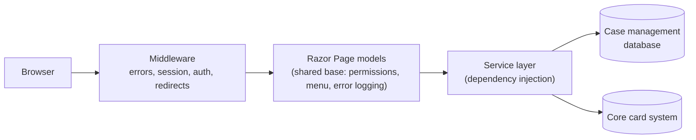

# FACE 2.0: Fraud Alert Capturing & Evaluation

**A web platform where a bank's fraud analysts triage suspicious card-transaction alerts, investigate, take action, and manage detection rules, re-engineered from a legacy system onto modern .NET.**

> **About this repository**
> This project was built in a professional setting and its source code is the property of my employer. This repository is a **portfolio write-up only**: it contains no source code, no client data and no internal system details. Names, figures and workflows are described at a general level.

---

## Overview

A real-time rules engine flags card transactions that look fraudulent. Those alerts land in this platform, where analysts review the cardholder's activity, decide whether it is fraud, and act: tag transactions, block the card, contact the customer, or schedule a follow-up. Supervisors tune the detection rules, manage analysts, and report on rule effectiveness and team performance.

The original system was built on ASP.NET Web Forms. I worked on **re-engineering it onto ASP.NET Core Razor Pages (.NET 10)** while keeping it fully compatible with the existing production database, the existing user accounts and the bank's core card system, so it could replace the old application without a data migration.

## My Role

- Migrated the full application (40+ screens) from Web Forms to ASP.NET Core Razor Pages on .NET 10.
- Built the analyst investigation workspace and the alert workflow.
- Integrated the core card system for card lookup and blocking.
- Implemented permission-based security, centralized error handling and structured logging.
- Delivered the reporting module with Excel and PDF export, plus a new dashboard and themeable UI.

## Key Features

**Alert handling**
- Alert queues scoped to each analyst's assigned risk categories, with filtering, sorting and paging.
- Investigation workspace showing the customer profile, risk summary, previous alerts, comment history and full transaction history.
- Cascading status, action and follow-up controls to close, escalate, reassign or reschedule an alert.
- Bulk tagging of transactions as fraud or genuine.
- Templated customer emails with an in-page editor and preview.
- Case search, rescheduled-alert lists and supervisor views of every analyst's workload.

**Rules management**
- Enable, disable, prioritise and tune detection rules, with every change written to an audit trail.
- Merchant-category and funds-transfer blocking rules applied directly on the core card system.

**Card operations**
- Card lookup and card blocking on the core card system, with the operator recorded.
- Transaction search with a wide range of filters, bulk tagging and export.

**Reporting**
- KPI dashboard with alert-distribution charts, quick actions and recent alerts.
- System statistics charts and **13 operational and audit reports** (rule effectiveness, false-positive ratio, analyst performance and more), with server-side paging and export to text, Excel and PDF.

**Administration**
- User creation and maintenance, role and risk-category assignment, account unlock, and password management.
- Navigation generated from the user's role, so each person sees only what they are permitted to use.

## Tech Stack

| Area | Technology |
|---|---|
| Framework | ASP.NET Core Razor Pages, .NET 10, C# |
| Databases | Microsoft SQL Server; IBM i (AS/400) DB2 for the core card system |
| Data access | ADO.NET with parameterized commands and stored procedures |
| Security | Cookie authentication, server sessions, permission-based authorization, image CAPTCHA |
| Exports | Excel and PDF generation libraries, delimited text |
| Logging | Serilog with rolling files, plus database exception logging |
| Front end | Bootstrap, jQuery, Highcharts, Chart.js, CSS design tokens with light and dark themes |
| Hosting | IIS on Windows Server, corporate intranet |

## Architecture

- **Thin pages, service layer for data.** Page models handle request flow; all data access sits behind injected service interfaces (100+ asynchronous operations).
- **Shared base page** providing permission checks, the role-based menu and consistent error logging for every screen.
- **Two data stores, one abstraction:** case data in SQL Server, and calls to the core card system only where an action must take effect on the card.

## Engineering Highlights

- **Zero-migration modernization.** Reused the existing database, stored procedures and user credential store unchanged, so the new application runs against the same production database as the old one.
- **Backward-compatible URLs.** Dozens of legacy page addresses permanently redirect to their new equivalents, so bookmarks and stored links keep working through cut-over.
- **Behavioural parity.** Workflow rules the business depended on were identified in the legacy code and preserved deliberately.
- **Safe error handling.** A global exception handler and status-code pages show users a friendly message with a reference ID, while full details go only to server logs. No framework or stack details ever reach the browser.
- **Session integrity.** Custom middleware keeps the authentication cookie and server session in sync so they cannot drift apart.
- **Offline-ready UI.** All fonts, scripts and chart libraries are self-hosted for an intranet without internet access.

## Scale

- 40+ screens, roughly 18,000 lines of C#, 9,000 lines of Razor markup and 6,000 lines of custom CSS.

## Skills Demonstrated

`C#` · `.NET 10` · `ASP.NET Core Razor Pages` · `Legacy migration (Web Forms)` · `SQL Server` · `Stored procedures` · `IBM i DB2` · `Dependency injection` · `Role-based access control` · `Secure error handling` · `Serilog` · `Reporting and export` · `Highcharts` · `Fraud operations domain`

---

**Sarim Nadeem** · MSc Computer Science · [LinkedIn](https://www.linkedin.com/in/msarimnadeem) · [GitHub](https://github.com/Sarim375)

*Source code is proprietary and not available. Happy to discuss the design and engineering decisions in an interview.*
